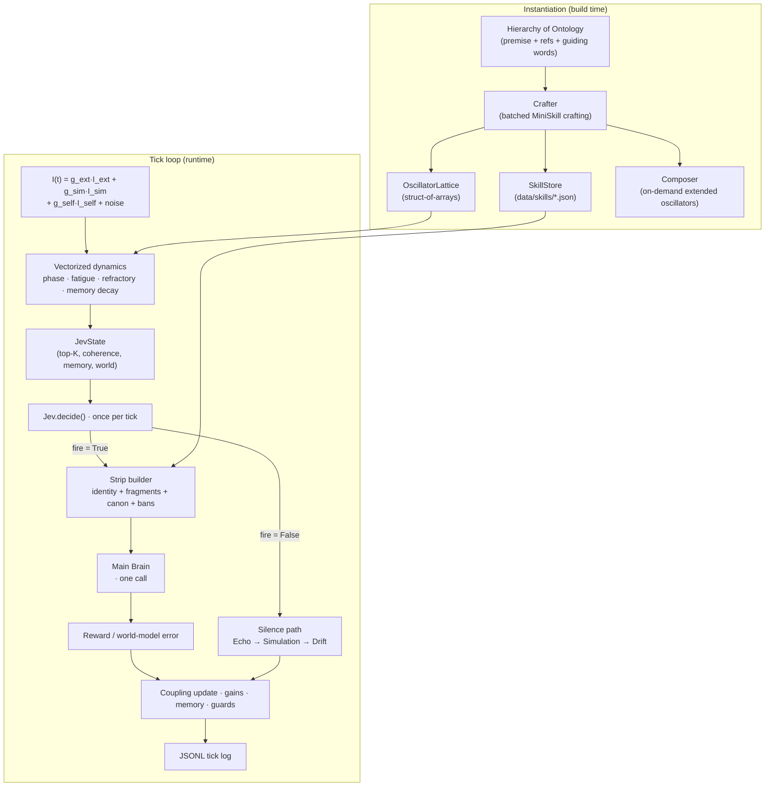
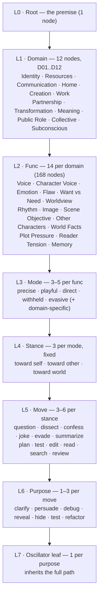

# oscillang

**An oscillator-gated nervous system for LLM agents.**


A cheap decision model (**Jev**) decides in parallel — over thousands of phase-coupled oscillators — which behavioral fragments should gate, fire, wait, avoid, or forget. The generative LLM (**Main Brain**) only renders text *inside* a fire decision.

> **Hard separation of powers:** Jev never generates text. Main Brain never decides. One `Jev.decide()` per tick, one Main Brain call per fire — never per oscillator, never per template. Everything inside a tick is vectorized numpy.

---

## Table of contents

1. [The core idea](#1-the-core-idea)
2. [Architecture](#2-architecture)
3. [The oscillator model](#3-the-oscillator-model)
4. [Instantiation: ontology → lattice → mini skills](#4-instantiation-ontology--lattice--mini-skills)
5. [Core dynamics: what happens every tick](#5-core-dynamics-what-happens-every-tick)
6. [Jev: the decision layer](#6-jev-the-decision-layer)
7. [Memory: leaky psychology, perfect canon](#7-memory-leaky-psychology-perfect-canon)
8. [World model](#8-world-model)
9. [The Strip: what Main Brain actually sees](#9-the-strip-what-main-brain-actually-sees)
10. [Guards](#10-guards)
11. [Reward, evaluation, ablation](#11-reward-evaluation-ablation)
12. [LLM layer](#12-llm-layer)
13. [Performance](#13-performance)
14. [Quickstart](#14-quickstart)
15. [Package layout](#15-package-layout)
16. [Implementation status](#16-implementation-status)
17. [Development](#17-development)

---

## 1. The core idea

A persona prompt is static: same input, same voice, forever. `oscillang` gives the agent an inner
dynamics instead. Behavioral fragments — *how to speak, what to hide, when to joke, which flaw
leaks out* — are not prompt text but **oscillators**: cyclic processes with their own frequency,
phase, amplitude, fatigue, refractory state and coupling to other fragments.

At every tick:

- oscillators advance on their own clocks (fast fragments spin at ~1 Hz, slow ones — worldview,
  core wounds — at ~0.05 Hz);
- fragments drift in and out of **phase lock** and **coherence** with the current state;
- **Jev** scores them all in one matmul and decides: gate a handful, fire one response, or stay silent;
- only when Jev fires does Main Brain render, and only from the fragments that gated (**the Strip**);
- using a fragment fatigues it (it decays and goes refractory), so the same task ten times in a row
  routes through a *different* fragment — the agent changes voice naturally;
- unused fragments recover; unused low-weight memories decay; canon never decays;
- a world model predicts, errs, and rewires coupling — contradiction, avoidance and forgetting
  become *motivated* behaviors with traceable causes.

## 2. Architecture



```
Jev.decide()  ──►  JevDecision (JSON, schema-validated)
                  { gate 0..1, fire bool, templateId, shift,
                    couplingDelta, gainDelta, evaluation, confidence }
```

## 3. The oscillator model

Stored as **struct-of-arrays** in the `OscillatorLattice` (never a list of objects) so every
per-tick operation is one vectorized call:

| Field | Meaning | Constraints |
|---|---|---|
| `id` | `OSC-D03-F02-M01-S01-MV02-P01` — the full ontology path, encoded for debugging | unique |
| `domain` | one of 12 domains `D01`–`D12` | fixed set |
| `func` | one of 14 functions (Voice, Flaw, World Facts, …) | fixed set |
| `mode, stance, move, purpose` | the ontology path below func | crafted vocab |
| `hz` | natural frequency; *frequency is not priority* — slow oscillators hold worldview | [0.01, 1.5] |
| `phase` | current angle | [0, 2π) |
| `amplitude` | strength; **fatigue = 1 − amplitude** | [0, 1] |
| `templateId` | link to its MiniSkill | 1:1 with skills |
| `lastFiredTick`, `refractoryUntilTick` | usage + recovery bookkeeping | |
| `embedding` | vector of the full path text | L2-normalized cache |
| `decayRate` | per-oscillator decay on use | |
| `coupling` | (N, N) matrix in [0,1] — dense below 20k oscillators, scipy.sparse above | top-20 partners at craft time |

## 4. Instantiation: ontology → lattice → mini skills

The same mechanism builds a **Book Lattice** and a **Code Lattice**; only the supplied hierarchy
and the func label map change (`Voice → Code Voice`, `Flaw → Failure Mode`, …).

### 4.1 The hierarchy (7 levels, fixed)



**No exceptions:** every L0 decomposes into all 12 domains; every domain into all 14 funcs.
A domain that seems irrelevant is kept with low initial coupling — never dropped. Total leaves
are the product of branching; the Crafter controls branching (never below the L3/L5/L6 minima)
and covers the remainder with **composition** (§4.5).

**Inputs:** root premise · 1–5 reference sources (name + sample text) · 3–7 guiding words ·
optional user-supplied hierarchy (validated, gaps filled) · radius 1–10 · optional Hz overrides.

### 4.2 Branching and scale targets

| Radius | Target oscillators | How |
|---|---|---|
| 1 | 2,000 | crafted subset of the full tree |
| 2 | 5,000 | crafted subset |
| 3 | 12,000 | crafted + composed |
| 4 | 20,000 | core ≤5,000 crafted, rest composed |
| 5 | 50,000 | core + composition |
| 6–10 | 100k–500k | core + composition |

Selection is an evenly-spaced deterministic subset of the tree's leaves so every domain/func
stays represented while branching limits stay intact (the hierarchy is never pruned below
L3≥3, L4=3, L5≥3, L6≥1 — that would fail the acceptance gate).

### 4.3 Hz assignment

Frequency encodes *what kind of thing a fragment is*, not its importance:

| Func | Hz | Func | Hz |
|---|---|---|---|
| Voice | 1.0 | Scene Objective | 1.0 |
| Rhythm | 1.2 | Other Characters | 0.6 |
| Character Voice | 0.8 | Image | 0.5 |
| Reader Tension | 0.3 | Emotion · Plot Pressure | 0.4 |
| Flaw · Want vs Need | 0.08 | World Facts | 0.07 |
| Worldview · Memory | 0.05 | | |

Per oscillator: `hz = baseHz × (0.9 + 0.2·rand)` — small jitter prevents perfect sync —
and `phase ~ U(0, 2π)` so nothing starts locked. Amplitude starts at 1.0, fatigue at 0.
User overrides (e.g. `{"Voice": 1.2}`) are applied *before* jitter.

### 4.4 One MiniSkill per oscillator — no orphans, nothing generic

Every oscillator decomposes into **exactly one** MiniSkill; every MiniSkill belongs to exactly
one oscillator. Main Brain crafts them in batches of 20 (one LLM call per batch, up to 3
concurrent batches), returning JSON per oscillator:

```json
{
  "oscillatorId": "OSC-D03-F02-M01-S01-MV02-P01",
  "trigger": "When the precise voice must dissect toward the other",
  "promptFragment": "Dissect to clarify. Use short sentences. Max 12 words per sentence. Ask one question, do not explain.",
  "examples": ["…from reference sources, rewritten to fit mode/stance/move…"],
  "constraints": ["maxAdjectivesPerSentence: 1", "sentenceLengthRule: 8 to 14 words"],
  "bannedPhrases": ["In conclusion", "It is important to note"],
  "evaluationCheck": "Check: output has at least one question and no sentence over 14 words."
}
```

**Reject rules** (re-craft once, then flag for review — never skip): empty trigger ·
promptFragment > 80 words · < 2 examples · < 2 constraints · < 3 bannedPhrases ·
empty evaluationCheck · promptFragment that is only adjectives (no imperative verb).
A deterministic, path-derived fallback skill is stored and flagged so the one-to-one
invariant survives any LLM failure.

**Coupling at craft time** encodes ontology proximity: same domain+func → 0.8, same domain → 0.5,
same func across domains → 0.4, otherwise 0.1; each oscillator keeps its **top-20 partners**
(no self-coupling); identical paths are merged (+0.1 coupling boost to the survivor); embedding
cosine > 0.98 pairs are kept but have their coupling cut to 0.2. Embeddings come from the full
path text (root + domain + func + mode + stance + move + purpose + guiding words) via a
pluggable `EmbeddingModel`.

### 4.5 Composition and promotion (radius ≥ 3)

You never craft 500,000 mini skills upfront. The first 2,000–5,000 are fully crafted
(**core**); the rest are **composed on demand**:

```
V = V_domain + V_func + V_mode + V_stance + V_move + V_purpose
```

where each `V_*` is the mean embedding of core oscillators with that component. A composed
oscillator immediately receives a **lightweight mini skill** (concatenation of its parents'
prompt fragments, trimmed to 80 words) so oscillator count == mini-skill count always holds.
After **more than 5 uses**, a composed fragment is **promoted**: Main Brain crafts a full
MiniSkill, it is persisted and marked `promoted`.

### 4.6 Batching, checkpoint, resume

- Batches of 20; after each batch: persist oscillators (`data/lattices/{id}/oscillators/batch_*.json`),
  skills (`data/skills/*.json`), and `checkpoint.json` (lastBatchIndex, completed batches, totals).
- Kill the build at any batch → rerun → it resumes from the last checkpoint, reloads completed
  batches, crafts only the pending ones; no duplicates, no restart from zero.
- Progress events stream per batch: `{stage, batch, total_batches, success, rejected, oscillators, mini_skills}`.

**Example pair from a real build trace** (path `Root / D03 Communication / Voice / precise / toward other / dissect / clarify`):

```json
{
  "oscillator": {"id": "OSC-D03-F01-M01-S02-MV02-P01", "hz": 0.94, "phase": 3.71,
                 "amplitude": 1.0, "fatigue": 0.0,
                 "templateId": "MS-D03-F01-M01-S02-MV02-P01"},
  "mini_skill": {"id": "MS-D03-F01-M01-S02-MV02-P01",
                 "oscillatorId": "OSC-D03-F01-M01-S02-MV02-P01",
                 "domain": "D03 Communication", "func": "Voice",
                 "trigger": "When speaking as Voice in D03 Communication with a precise register aimed toward other",
                 "promptFragment": "dissect to clarify. Keep sentences short and concrete, aimed toward other; no meta commentary.",
                 "examples": ["[Sample Author] …"], "constraints": ["maxAdjectivesPerSentence: 1", "sentenceLengthRule: 8 to 14 words", "mustInclude: clarify"],
                 "bannedPhrases": ["In conclusion", "As an AI", "It is important to note"],
                 "evaluationCheck": "Check: output dissects toward toward other and avoids In conclusion."}
}
```

## 5. Core dynamics: what happens every tick

Everything below is one vectorized numpy call — **no Python loop over oscillators exists in
`core/`** (a static test fails the build if one appears).

| Mechanism | Rule |
|---|---|
| Phase | `phase = (phase + 2π·hz·step) mod 2π` |
| Kuramoto coupling (optional, off by default) | `dphase += K·Σⱼ Cᵢⱼ·sin(φⱼ−φᵢ)` — computed as two matvecs via the sin/cos identity |
| Coherence | `V·Vᵀ` on L2-normalized embeddings; optional `query_aware` adds similarity to a state vector built from I(t), scene objective, recent thoughts |
| Lock gating | gate **only if** wrapped phaseDiff < 0.4 rad **AND** coherence > 0.6. High similarity with low phase lock must NOT gate |
| Fatigue on use | `amp = amp·decayPerUse + recoveryPerTick` (0.08 / 0.02) |
| Recovery | unused: `amp += recoveryPerTick`, clamped [0,1]; unused fragments drift toward baseline 0.5 |
| Refractory | 2 ticks for fast oscillators (hz ≥ 0.6), 5 ticks for slow |
| Coupling plasticity | `C += Δ·fireMask`, Δ ∈ [−0.1, 0.1], STDP-style credit (fired-just-before-success strengthens; before failure weakens), ×0.999 decay per tick, clamp [0,1] |
| Retrieval | one batched top-K (K = 8–16) by embedding similarity (+ phase coherence), FAISS if installed else numpy |

Input signal: `I(t) = g_ext·I_ext + g_sim·I_sim + g_self·I_self + noise` with gains 1.0 / 0.3 / 0.5.
In silence `g_ext` decays while `g_sim` and `g_self` rise, and the progression runs
**Echo → Simulation → Drift**; after 10 silent ticks a watchdog injects a self-prompt tagged
`ext/sim/self`.

## 6. Jev: the decision layer

Three interchangeable implementations behind one interface, **exactly one `decide()` per tick**:

| Jev | Mechanism |
|---|---|
| `RuleJev` (default, baseline) | `score = w_coh·coherence + w_phase·phaseAlign + w_mem·memWeight − w_fat·fatigue − w_cost·emotionalCost + w_coup·coupling + noise` — one matmul over candidates. Membrane potential `V` accumulates while coherence is high and decays otherwise; **fire when `V ≥ 0.65`**, then reset and set refractory. Select by argmax; ties broken by coupling history, then fatigue |
| `LLMJev` | one structured-output call per tick, schema-validated, retry once, fall back to RuleJev |
| `MLPJev` | small 2-layer MLP distilled from logged `(state, decision, reward)` triples |

The decision is JSON-only and schema-validated:
`{gate, fire, templateId, shift, couplingDelta, gainDelta, evaluation, confidence}`.
A frozen baseline Jev is kept for comparison. Every tick logs `JevState`, `JevDecision`,
Strip, output, reward, prediction error, gains, fireMask to JSONL.

## 7. Memory: leaky psychology, perfect canon

Two deliberately unequal stores:

- **LeakyMemory** — items with decayRate, emotionalWeight, lastRefreshed. `I_self = I_self·αᵏ`
  (α = 0.95); low-weight items fade after ~20 ticks unless refreshed; high-weight *wounds persist*.
  Pruned at 10,000 items (lowest weight, oldest refresh first). This is where forgetting,
  avoidance and contradiction live.
- **CanonStore** — separate, **non-decaying, exact-recall** store for facts, timeline, names and
  world rules. Always injected into the Strip, never subject to forgetting or noise.
  Psychology leaks; canon is perfect.

## 8. World model

Per-domain rules plus `otherAgent {want, need, flaw, lastAction, predictedNextAction}`:

- **Fast loop:** thought → prediction → feeds `I_sim`.
- **Medium loop:** `error = actual − predicted` updates coupling and world state.
- **Slow loop:** rules that repeatedly mispredict get rewritten in a background task.

The predictor is an LLM call behind an interface — cacheable and skippable via config.

## 9. The Strip: what Main Brain actually sees

Rebuilt on every fire, never identical, always logged:

```
Strip = identityBlock + instantiationTemplate
      + one fragment per active (gated) oscillator
      + memory block            ← leaky
      + canon block             ← exact
      + scene objective
      + anti-slop bans          ← union of active skills' bannedPhrases
      + output rules
```

Contradictory constraints between fragments are detected and logged as warnings —
that contradiction is usually the *point* (see reward).

## 10. Guards

| Condition | Action |
|---|---|
| Coherence ≈ 0 for 20 ticks | inject noise, reset phase of 10% of oscillators |
| Fire rate 0 for 10 ticks | `Vth − 0.05` temporarily |
| Fire rate 1.0 for 20 ticks | `Vth + 0.05` temporarily |
| Coupling saturated | global decay ×0.99 |

## 11. Reward, evaluation, ablation

`+1` motivated contradiction · motivated forgetting · motivated avoidance · fatigue-driven shift.
`−1` unmotivated contradiction · perfect memory · staying on task in silence · random drift.
A pluggable LLM judge scores, with a rule-based fallback. Coupling updates apply immediately;
Jev weight updates are slow and batched.

`eval/ablation.py` re-runs the same scenarios with each mechanism disabled independently
(phase gating, coupling plasticity, fatigue, refractory, noise, leaky memory, world model,
learned Jev) across variants: (1) plain persona + memory, (2) + fatigue/refractory/decay/noise,
(3) + phase/coupling, (4) + learned Jev — producing a comparison report that *proves* which
mechanisms earn their keep.

**Acceptance behaviors under test:** 20k oscillators under 150 ms/tick · lock-resonance gating ·
fatigue forces skill rotation after 10 same tasks · low-weight memories fade while wounds and
canon persist · high-cost topics avoided then revisited · 10 silent ticks shift gains ·
contradictions traceable to domain/fatigue/cost · same brain on different lattices is clearly
different (embedding metrics) · no for-loops in `core/`.

## 12. LLM layer

Provider-agnostic seam — one `ChatModel` Protocol (`invoke` / `ainvoke`, `InvokeOptions`,
normalized `ChatResponse`), with adapters:

- `llm/openai.py` — `OpenAIChat` (lazy import; injectable client for offline tests)
- `llm/anthropic.py` — planned (next milestone)
- `llm/fake.py` — `FakeChatModel`: deterministic, template-based, records its calls — every
  acceptance test runs reproducibly with seed + FakeChatModel.

## 13. Performance

Measured (Windows, Python 3.11, numpy): core tick = dynamics + retrieval top-K + candidate
coherence + lock gating + coupling read/decay.

| Scenario | p50 tick | Budget |
|---|---|---|
| 2,000 oscillators (dense coupling) | ~4.8 ms | 50 ms |
| 20,000 oscillators (sparse coupling ≥ 20k) | ~0.8 ms | 150 ms |
| 200,000 composed oscillators (build + 3 ticks) | ~170 ms total | 400 ms |

`core/` test coverage: **94%**. `ruff` and `mypy` clean. 20k dense coupling would cost 1.6 GB and
~100 ms per decay sweep, hence the sparse backend at ≥ 20k.

## 14. Quickstart

```python
from oscillang.llm.fake import FakeChatModel
from oscillang.skills.model import InstantiationSpec, Reference
from oscillang.skills.crafter import Crafter

spec = InstantiationSpec(
    premise="A burned-out translator rediscovers her voice in a collapsing city",
    references=[Reference(name="Sample Author", sample_text="…prose sample…")],
    guiding_words=["frayed", "luminous", "stubborn"],
    radius=1,                       # 2,000 oscillators
)

crafter = Crafter(chat_model=FakeChatModel(), lattice_id="translator", seed=0)
result = crafter.build(spec)        # hierarchy → oscillators → mini skills → coupling

print(result.actual, result.mini_skills)   # 2000 2000 — always one-to-one
lattice = crafter.lattice
```

Run ticks with the vectorized core (fire decisions arrive with the Jev milestone):

```python
import numpy as np
from oscillang.core import Config, step_lattice
from oscillang.core.coherence import coherence_query
from oscillang.core.gating import lock_gate, phase_diff_to_reference

config = Config().validated()
rng = np.random.default_rng(7)
state = rng.normal(size=config.embedding_dim).astype(np.float32)

for tick in range(50):
    step_lattice(lattice, tick, config)                       # phase/fatigue/refractory
    coh = coherence_query(lattice.normalized_embeddings, state)  # O(N·d)
    ...
```

LangChain-style composition (`agent | OutputParser | Postprocess`), callbacks, and
`Scene`/`Beat` mode land with the runtime milestone.

### Runtime: one turn of the loop

`Runtime.respond` is the fire decision end to end:

1. **Encode** the user input; state vector = `g_ext`·input + `g_sim`·memory
   trace + `g_self`·last output (`compose_state_vector`).
2. **Perturb** phases — external drive proportional to coherence, plus guard
   noise injection after dead-coherence watchdogs.
3. **Score** every oscillator with the numeric Jev: coherence (measured
   against skill texts, not path texts), phase proximity, memory, amplitude,
   minus use cost and coupling pressure, plus seeded noise.
4. **Fire decision**: candidate pool = Jev above the adaptive threshold and
   not refractory; the top-Jev oscillator leads, and the rest fire only when
   phase-locked AND coherent with the leader (M1's lock gate, pairwise);
   capped at `top_k`. Main Brain renders **once** for the whole fired set.
5. **Step** the lattice (phase, fatigue, refractory), `record_use` each fired
   skill (promotion after > 5 uses), update the leaky memory trace, run the
   guards (threshold drop / raise, noise inject, silence nudge).

```python
from oscillang.runtime import Runtime
from oscillang.skills.crafter import Crafter
from oscillang.skills.model import HashingEmbedder

crafter = Crafter(chat_model=my_chat, lattice_id="my-lattice")
crafter.build(spec)                                   # 2k oscillators + mini skills
runtime = Runtime(
    lattice=crafter.lattice, store=crafter.store,
    chat_model=my_chat, embedder=HashingEmbedder(dim=crafter.config.embedding_dim),
    premise=spec.premise, guiding_words=spec.guiding_words,
)
result = runtime.respond("She asked about the missing page")
print(result.response)          # Main Brain's rendered beat
print(result.fired_ids)         # oscillators that gated open
print(result.skill_ids)         # their one-to-one mini skills (used_count++)
```

## 15. Package layout

```
oscillang/
  core/      lattice.py coherence.py gating.py dynamics.py coupling.py banks.py config.py
  skills/    model.py store.py checkpoint.py crafter.py composer.py
  llm/       base.py openai.py fake.py
  jev/       base.py rule_jev.py llm_jev.py mlp_jev.py schema.py        (next milestone)
  memory/    leaky.py canon.py
  world/     model.py
  strip/     builder.py
  runtime/   tick_loop.py guards.py session.py
  eval/      reward.py acceptance.py ablation.py
  logging/   jsonl.py
  chains/    runnable.py
  cli.py
tests/
examples/
```

## 16. Implementation status

| Component | Status |
|---|---|
| `core/` — lattice, coupling, dynamics, coherence, gating | ✅ done (M1) |
| `llm/` — ChatModel protocol, OpenAI adapter, FakeChatModel | ✅ done |
| `skills/` — ontology, crafter, store, checkpoint, composer | ✅ done (M2) |
| `runtime/` — perturb → Jev gate → fire → Main Brain render, guards, leaky memory | ✅ done (M3) |
| `jev/` — RuleJev (default), LlmJev (one call per fire decision), MlpJev (learned hook), schema | ✅ done (M4) |
| `memory/`, `world/`, `strip/`, `eval/`, `logging/`, `chains/`, `cli.py` | 🔜 next milestones |

## 17. Development

```bash
pip install -e ".[dev]"          # numpy, pydantic, scipy, pytest, ruff, mypy
pip install -e ".[openai]"       # optional: real OpenAI adapter
pytest                           # all tests (deterministic; FakeChatModel, seeded)
ruff check oscillang tests && ruff format oscillang tests
mypy oscillang
pytest --cov=oscillang/core --cov-report=term
```

Design invariants enforced by tests: no `for`/`while` over oscillators in `core/` (AST check),
dense/sparse coupling parity, lock-resonance gating truth table, one-to-one oscillator↔skill,
checkpoint resume with zero duplicates.
